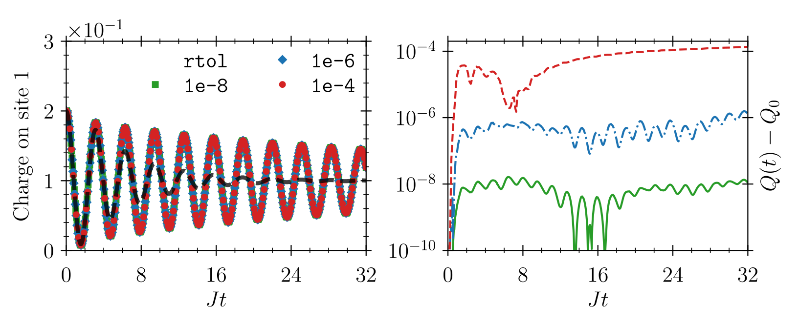

# [Fermi-Hubbard Model II](@id FHM_II)

!!! note
    This example is the continuation of [Fermi-Hubbard Model I](@ref FHM_I). It is recommended that you familiarize yourself with the latter first.

In part II of our example about the Fermi-Hubbard model, we will solve the so-called ``T``-matrix approximation, which is a "non-perturbative" self-energy resummation. As we saw in [part I](@ref FHM_I), in the standard perturbative second Born approximation, the self-energies are given by
```math
\begin{align*}
    \Sigma^\lessgtr_{ij, \uparrow}  (t, t') = \mathrm{i}U(t)U(t') \Phi^\lessgtr_{ij}(t, t') G^\gtrless_{ji, \downarrow}(t', t),\\
    \Sigma^\lessgtr_{ij, \downarrow}(t, t') = \mathrm{i}U(t)U(t') \Phi^\lessgtr_{ij}(t, t')G^\gtrless_{ji, \uparrow}(t', t),
\end{align*}
```
where
```math
\begin{align*}
    \left[\boldsymbol{\Phi}^\lessgtr(t, t')\right]_{ij} = \Phi^\lessgtr_{ij}(t, t') = -i G^\lessgtr_{ij, \uparrow}(t, t') G^\lessgtr_{ij, \downarrow}(t, t').
    \end{align*}
```
If we now define the so-called ``T``-matrix
```math
\begin{align*}
    \boldsymbol{T}(t, t') =  \boldsymbol{\Phi}(t, t') - \int_{\mathcal{C}}\mathrm{d}s\; \boldsymbol{\Phi}(t, s) U(s) \boldsymbol{T}(s, t'),
\end{align*}
```
the new self-energies in ``T``-matrix approximation become
```math
\begin{align*}
    \Sigma^\lessgtr_{ij, \uparrow}  (t, t') = \mathrm{i}U(t)U(t') T^\lessgtr_{ij}(t, t') G^\gtrless_{ji, \downarrow}(t', t),\\
    \Sigma^\lessgtr_{ij, \downarrow}(t, t') = \mathrm{i}U(t)U(t') T^\lessgtr_{ij}(t, t')G^\gtrless_{ji, \uparrow}(t', t),
\end{align*}
```

While we keep the _same initial conditions_ as in [Fermi-Hubbard Model I](@ref FHM_I), we intrdoce a new data `struct` that also holds the ``T``-matrix (and the "bubbles" ``\Phi`` since this is more efficient):
```julia
Base.@kwdef struct FermiHubbardDataTM{T}
    GL_u::T
    GG_u::T
    GL_d::T
    GG_d::T

    ΣL_u::T = zero(GL_u)
    ΣG_u::T = zero(GG_u)
    ΣL_d::T = zero(GL_d)
    ΣG_d::T = zero(GG_d)

    TL::T = zero(GL_u)
    TG::T = zero(GG_u)

    ΦL::T = zero(GL_u)
    ΦG::T = zero(GG_u)
end

data = FermiHubbardDataTM(GL_u=GL_u, GG_u=GG_u, GL_d=GL_d, GG_d=GG_d)

# Initialize T-matrix
data.TL[1, 1] = -1.0im .* GL_u[1, 1] .* GL_d[1, 1]
data.TG[1, 1] = -1.0im .* GG_u[1, 1] .* GG_d[1, 1]
data.ΦL[1, 1] = data.TL[1, 1]
data.ΦG[1, 1] = data.TG[1, 1]
```
!!! note
    As should be clear from the new definition of the self-energies in terms of the ``T``-matrix, the former now contain additional time integrals. This means that at every time step, on top of the Volterra integro-differential equations (VIDEs), we now also have to solve so-called _Volterra integral equations_ (VIEs). Furthermore, it is important for stability reasons to solve these VIEs _implicitly_. For a more detailed discussion, please consult [our paper](https://doi.org/10.21468/SciPostPhysCore.5.2.030).

For each pair of times, only the newest endpoint remains unknown in the
quadrature sums. The equations are linear in these endpoint matrices, so they
can be solved directly. Write the known contributions as ``b_L,b_G`` and set
``A=I+q_1(t)(\Phi^>(t,t)-\Phi^<(t,t))``, where ``q_a(s)=h_a(s)U(s)``.
Away from the diagonal, ``A T^<=b_L`` and ``A T^>=b_G``. On the diagonal,
``q_1(t)=q_2(t)`` and subtracting the two equations gives
``\Delta=T^>-T^<=b_G-b_L``. The remaining solve is
``A T^<=b_L+q_2(t)\Phi^<(t,t)\Delta``.

[As in part I](@ref FHM_I), we define our `FermiHubbardModel`, yet this time with a stronger interaction:
```julia
# Interaction parameter
const U₀ = 2.0
model = FermiHubbardModel(U = t -> U₀)
```
The previous callback `second_Born!` is now replaced with the following:
```julia
# Callback function for the self-energies
function T_matrix!(model, data, times, h1, h2, t, t′)
    (; GL_u, GG_u, GL_d, GG_d, TL, TG, ΣL_u, ΣG_u, ΣL_d, ΣG_d, ΦL, ΦG) = data
    (; U) = model

    if (n = size(GL_u, 3)) > size(ΣL_u, 3)
        resize!(ΣL_u, n)
        resize!(ΣG_u, n)
        resize!(ΣL_d, n)
        resize!(ΣG_d, n)
        resize!(TL, n)
        resize!(TG, n)
        resize!(ΦL, n)
        resize!(ΦG, n)
    end

    if t′ == 1
        for s in 1:t
            ΦL[t, s] = -1.0im .* GL_u[t, s] .* GL_d[t, s]
            ΦG[t, s] = -1.0im .* GG_u[t, s] .* GG_d[t, s]
        end
    end

    q1 = h1 .* U.(view(times, 1:length(h1)))
    q2 = h2 .* U.(view(times, 1:length(h2)))
    bL = ΦL[t, t′] - integrate1(q1, t, t′, ΦG, ΦL, TL; tmax=t-1) -
        integrate2(q2, t, t′, ΦL, TL, TG; tmax=min(t′, t-1))
    bG = ΦG[t, t′] - integrate1(q1, t, t′, ΦG, ΦL, TG; tmax=t-1) -
        integrate2(q2, t, t′, ΦG, TL, TG; tmax=min(t′, t-1))
    A = lu(I + q1[t] * (ΦG[t, t] - ΦL[t, t]))
    if t′ == t
        Δ = bG - bL
        TL[t, t] = A \ (bL + q2[t] * ΦL[t, t] * Δ)
        TG[t, t] = TL[t, t] + Δ
    else
        TL[t, t′] = A \ bL
        TG[t, t′] = A \ bG
    end

    U_tt′ = U(times[t]) * U(times[t′])
    ΣL_u[t, t′] = 1.0im .* U_tt′ .* TL[t, t′] .* transpose(GG_d[t′, t])
    ΣL_d[t, t′] = 1.0im .* U_tt′ .* TL[t, t′] .* transpose(GG_u[t′, t])
    ΣG_u[t, t′] = 1.0im .* U_tt′ .* TG[t, t′] .* transpose(GL_d[t′, t])
    ΣG_d[t, t′] = 1.0im .* U_tt′ .* TG[t, t′] .* transpose(GL_u[t′, t])
end
```
For a given final time `tmax`, and tolerances `atol` and `rtol`, [`kbsolve!`](@ref) is ready to solve the problem:
```julia
# Call the solver
sol = kbsolve!(
        (x...) -> fv!(model, data, x...),
        (x...) -> fd!(model, data, x...),
        [data.GL_u, data.GG_u, data.GL_d, data.GG_d],
        (0.0, tmax);
        callback = (x...) -> T_matrix!(model, data, x...),
        atol = atol,
        rtol = rtol,
        dtini=1e-10,
        stop = x -> (println("t: $(x[end])"); flush(stdout); false)
    )
```
The published comparison at `tmax=32` and `atol = 1e-2 rtol` is shown below. It
predates the Hartree-sign correction in the present examples.



This confirms that the resummation performed by the T-matrix is indeed superior to the second Born approximation in the current regime of large ``U`` and small occupation numbers!
